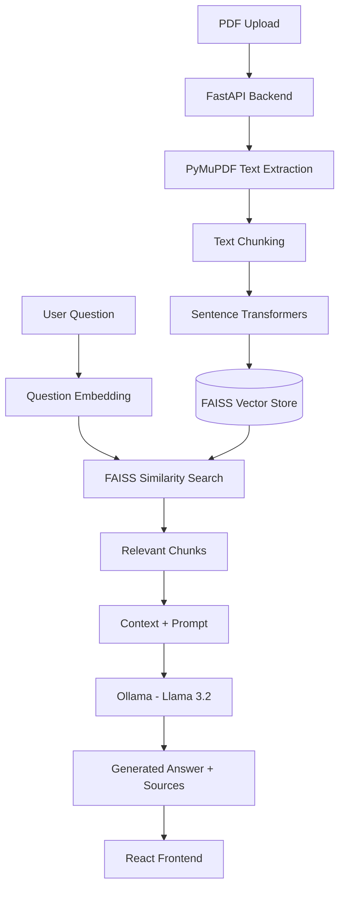

# AI Document Q&A System

An AI-powered **Retrieval-Augmented Generation (RAG)** application that allows users to upload PDF documents and ask questions about their contents.

The system extracts document text, converts it into semantic embeddings, retrieves relevant information using FAISS, and generates context-aware answers using a locally running LLM through Ollama.

Unlike a general-purpose chatbot, the application is designed to ground its responses in the uploaded document and provide source references so users can trace the information back to the original PDF.

## ✨ Features

- **PDF Upload:** Upload PDF documents through a React-based interface.
- **Text Extraction:** Extract text and page information using PyMuPDF.
- **Intelligent Chunking:** Split extracted text into smaller, overlapping chunks while preserving page references.
- **Semantic Embeddings:** Convert document chunks and user queries into vector representations using Sentence Transformers.
- **Vector Similarity Search:** Use FAISS to retrieve relevant document chunks efficiently.
- **Context-Grounded Answers:** Generate answers using retrieved document context and a local LLM.
- **Source References:** Display the document pages and retrieved passages used to generate answers.
- **Local AI Processing:** Run document processing, embeddings, and LLM inference locally without relying on external AI APIs.
- **Modern User Interface:** Interact with documents through a React-based frontend.

## 🏗️ System Architecture

The application follows a Retrieval-Augmented Generation (RAG) architecture with separate document-ingestion and question-answering workflows.

### Architecture Diagram




### Architecture Components

| Component | Responsibility |
|---|---|
| React Frontend | PDF upload, question input, answer and source display |
| FastAPI | Handles upload and question-answering requests |
| PyMuPDF | Extracts text and page information from PDFs |
| Chunking Module | Splits extracted text into manageable chunks |
| Sentence Transformers | Generates semantic embeddings |
| FAISS | Performs vector similarity search |
| Ollama | Runs the local LLM and generates answers |
| Llama 3.2 | Produces responses grounded in retrieved context |

## 🔌 API Design

| Method | Endpoint | Description |
|---|---|---|
| POST | `/upload` | Upload a PDF and create its FAISS vector index. |
| POST | `/ask` | Ask questions and receive document-based answers with sources. |


### 3. API Documentation

FastAPI automatically provides interactive API documentation.

Once the backend is running, access:

- Swagger UI: `http://localhost:8000/docs`


## 🛠️ Tech Stack

### Frontend
- React
- Vite
- CSS

### Backend
- Python
- FastAPI
- PyMuPDF

### AI / RAG
- Sentence Transformers
- FAISS
- Ollama
- Llama 3.2 (3B)

## 🚀 Running the Project

### 1. Clone the Repository

```bash
git clone https://github.com/YOUR_USERNAME/AI-Document-QA.git
cd AI-Document-QA
```

### 2. Backend Setup

```bash
cd backend

python -m venv venv
```

Activate the virtual environment on Windows:

```bash
venv\Scripts\activate
```

Install dependencies:

```bash
pip install -r requirements.txt
```

Start the FastAPI server:

```bash
python -m uvicorn main:app --reload
```

Backend URL: `http://localhost:8000`

### 3. Ollama Setup

Install Ollama and download the model:

```bash
ollama pull llama3.2:3b
```

Ensure Ollama is running before submitting questions.

### 4. Frontend Setup

Open another terminal:

```bash
cd frontend

npm install

npm run dev
```

Open the URL displayed by Vite, usually:

`http://localhost:5173`

## 💡 How It Works

1. The user uploads a PDF through the React interface.
2. FastAPI receives and validates the uploaded file.
3. PyMuPDF extracts text along with page information.
4. The extracted text is divided into smaller, overlapping chunks.
5. Sentence Transformers converts each chunk into a vector embedding.
6. FAISS stores the embeddings in a vector index.
7. The user submits a question through the frontend.
8. The question is converted into an embedding using the same embedding model.
9. FAISS searches for semantically relevant document chunks.
10. The retrieved context is passed to Ollama along with the question.
11. Llama 3.2 generates an answer based on the supplied context.
12. The frontend displays the generated answer and its source references.

## 🔒 Local AI and Privacy

The application is designed to run locally:

- PDF extraction and embedding generation happen on the local machine.
- FAISS performs similarity search locally.
- Ollama runs the language model locally.
- No external LLM API is required.

This keeps document processing within the local application environment, provided the application and its dependencies are configured to use local services.

## 📌 Current Limitations

- Supports one active uploaded document at a time.
- OCR is not currently implemented for scanned or image-only PDFs.
- Vector indexes and document chunks are maintained in memory.
- Document processing and retrieval are not yet persisted across application restarts.
- Retrieval quality depends on chunking, embedding quality, and similarity thresholds.

## 🔮 Future Improvements

- Multi-document support.
- Chat history and conversational memory.
- Improved retrieval using hybrid search and reranking.
- OCR support for scanned PDFs.
- Source highlighting within the original PDF.
- Better context management for large documents.

